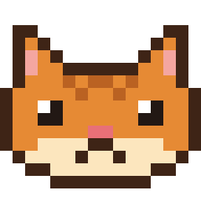

# ScreenPet

Masaüstünde dolaşan piksel sanat bir kedi. Tüm pencerelerin üstünde durur, boş
alanlara tıklamalar alttaki pencerelere geçer. Windows için yazıldı.



## Neler yapar

- Masaüstünde dolaşır, oturur, gülümser, yorulunca evine gidip uyur.
- **Mutluluk, açlık ve uyku** istatistikleri var. Kapatıp açınca kaldığı yerden devam eder.
- Topla oynar. Topu tutup fırlatabilirsin, yakalaması kediyi mutlu eder.
- Birden fazla monitörde dolaşabilir. Her monitörün DPI ölçeğine göre boyutlanır.
- Kedinin, evin ve topun rengi değiştirilebilir. Tüm görseller kendi PNG dosyalarınla değiştirilebilir.
- Türkçe ve İngilizce arayüz.

## Kullanım

| Eylem | Nasıl |
| --- | --- |
| Kediyi, evi veya topu taşı | Sol tıkla ve sürükle |
| Kediyi sev | Kediye hızlıca 3 kez tıkla |
| Kedinin durumunu gör | Kediye sağ tıkla |
| Top, yemek, ayarlar | Eve sağ tıkla |
| Kediyi eve gönder | Eve çift tıkla (yorgunsa uyur) |
| Topu fırlat | Topu tut, sürükleyip bırak |
| Gizle / göster | Tepsi simgesine tıkla, Alt+F4 ya da ev menüsünden **Gizle** |
| Kapat | Tepsi simgesine sağ tıkla → **Çıkış**, ya da ev menüsünden **Çıkış** |

Alt+F4 uygulamayı kapatmaz, sadece gizler. İlk gizlemede bir bildirim bunu hatırlatır.

### İstatistikler

| | Azalma | Artırmak için |
| --- | --- | --- |
| Açlık | ~6 saatte tok → aç | Ev menüsünden **Besle** |
| Mutluluk | ~4 saatte | Besle, sev, top yakalat |
| Uyku | ~5 saatte | Kedi enerjisi azalınca kendisi eve gidip uyur (~10 dk) |

Uygulama kapalıyken istatistikler 4 kat yavaş düşer ve 25'in altına inmez.
Yaş, kedinin ilk açıldığı günden itibaren gün olarak sayılır.

## Kurulum (kaynak koddan)

Python 3.10 veya üstü gerekir.

```bash
pip install -r requirements.txt
```

```bash
python start.py
```

## EXE derleme

```bash
pip install -r requirements-dev.txt
```

```bash
pyinstaller ScreenPet.spec
```

Çıktı `dist/ScreenPet.exe`. Tek dosyadır, kurulum gerektirmez.

## Testler

```bash
python -m unittest discover -s tests
```

## Veriler nerede durur

Ayarlar (`ayarlar.json`), kullanıcı görselleri (`Assets/<tür>/UserSchema/`) ve
EXE'nin günlük dosyası (`screenpet.log`) EXE'nin yanındaki klasörde tutulur.
O klasör yazılamıyorsa (örneğin Program Files) `%APPDATA%\ScreenPet` kullanılır.

## Kendi görsellerin

Ayarlar → **Görseller** sekmesinde her görselin altında **Değiştir** var. Seçtiğin
dosya kalıcı klasöre kopyalanır ve hemen kullanılır. **Sıfırla** varsayılana döner.
Şeffaf arka planlı PNG önerilir. Pencere şeffaflığı tek bir renk anahtarıyla
çalıştığı için yarı saydam pikseller ya tam görünür ya tam saydam olur.

## Proje yapısı

```
start.py                 Başlatıcı
screenpet/
  app.py                 Ana döngü, olaylar, kullanıcı eylemleri
  world.py               Kedi, ev, top ve etkileşimler, çizim
  pet.py                 Kedinin istatistikleri ve davranışı
  ball.py                Top fiziği
  particles.py           Efektler
  assets.py              Görsel yükleme, renklendirme, değiştirme
  display.py             Tüm monitörleri kaplayan şeffaf pencere
  winapi.py              Windows API: DPI, monitörler, başlangıç kaydı
  settings.py            ayarlar.json okuma/yazma ve eski sürümden geçiş
  i18n.py                Dil desteği (languages.json)
  tray.py                Sistem tepsisi simgesi
  theme.py               Renkler ve yazı tipleri
  ui/                    Menüler ve ayarlar paneli
tools/make_icon.py       Uygulama ikonunu üretir
tests/                   Birim testleri
```

## Lisans

[MIT](LICENSE)
